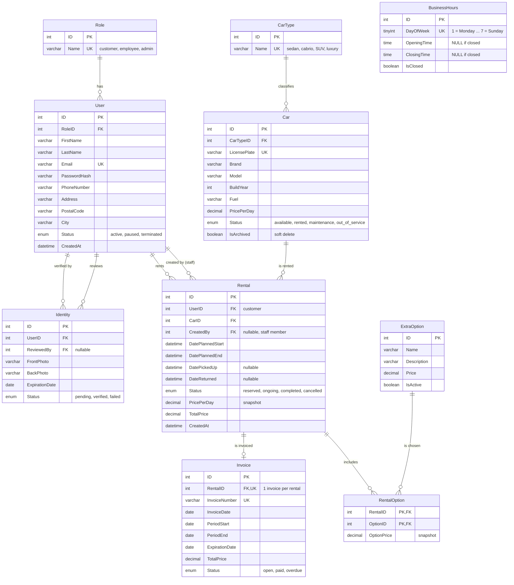

# ERD v2 – Rent-a-Car (samengevoegd)

Basis: ERD van Cavo, aangevuld met Identity (Gio), autotype, extra's, `CreatedBy` en geplande/werkelijke datums.



## Wijzigingen t.o.v. Cavo's ERD

| Wijziging | Reden |
|---|---|
| `ExtraOption` + `RentalOption` toegevoegd aan het diagram | Extra's staan in de casus |
| `CarType` + `Car.CarTypeID` | Autotype staat in de casus |
| `Rental.CreatedBy` | Reservering namens klant door medewerker (US3) |
| `DatePlannedStart/End` + `DatePickedUp/DateReturned` | Ophalen/terugbrengen registreren en te laat inleveren (US5) |
| `Car.IsArchived` | Auto's met reserveringen niet echt verwijderen |
| `User.PostalCode` | NAW-gegevens volledig |
| `Identity` (van Gio) | Optioneel, alleen als ID-verificatie gebouwd wordt |
| `Invoice.PeriodStart/PeriodEnd` | Casus vraagt periodedatum op de factuur |
| `BusinessHours.DayOfWeek` als tinyint | Was varchar(20) |

## Opmerkingen

- `Invoice.RentalID` is uniek, dus een reservering heeft maximaal één factuur.
- `ExtraOption.Price` is een bedrag per reservering (zoals bij Cavo). Wil je team een prijs per dag, pas dan de berekening in `TotalPrice` aan.
- Overlapcontrole bij reserveren (reserveringen met status ≠ cancelled):

```sql
SELECT 1 FROM Rental
WHERE CarID = @carId
  AND Status <> 'cancelled'
  AND DatePlannedStart < @newEnd
  AND DatePlannedEnd   > @newStart;
```
